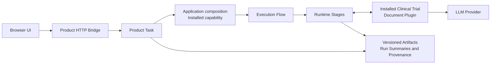
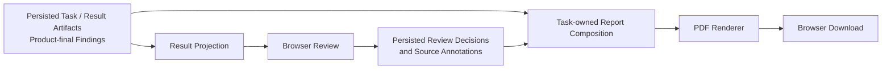

# Architecture

AI QC Engine provides reusable QC execution and review infrastructure. **Clinical Trial Document QC** is the current installed domain product, and **Writing Accuracy & Consistency Review（撰写准确性与一致性核查）** is its currently implemented QC function. Within that function, the installed analysis scope is **Investigational Product Clinical Safety**, represented in execution by the `clinical_safety` semantic module.

## Scope and Design Goals

The design makes execution ownership explicit, keeps stage handoffs inspectable, and retains source evidence through finding generation and human review.

- **Explicit ownership:** Product Tasks own user inputs and child Flow membership; Flows own sequencing and checkpoints.
- **Deterministic contracts:** schemas, identities, validation, and artifact handoffs constrain model inputs and outputs.
- **Traceable execution:** persisted summaries connect admitted inputs, stages, findings, and review state.
- **Domain separation:** application composition installs clinical plugins into reusable execution contracts.
- **Human review:** findings remain separate from reviewer decisions and source annotations.

Deterministic contracts do not mean deterministic LLM output. Persisted provenance supports inspection of a run; it does not promise identical findings from a later model call.

## System Overview

### Execution architecture



The HTTP bridge materializes requests and delegates to Task/application use cases. Application composition installs clinical plugins and LLM bindings; the Flow sequences runtime stages through explicit contracts. Runtime and Task persistence retain outputs and execution identities.

### Review and report lifecycle



Generated findings and saved human review/annotation state are separate persisted concerns. Result projection exposes findings and source evidence to the browser; report composition combines persisted execution data with saved reviewer state for an on-demand PDF. The browser consumes read models and review APIs; it does not execute QC or call LLMs.

## Ownership and Dependency Boundaries

| Owner                                              | Responsibility                                                                                                |
| -------------------------------------------------- | ------------------------------------------------------------------------------------------------------------- |
| **Product Task** (`task/`)                 | User input topology, admitted input ownership, TaskRun lifecycle, and child Flow membership                   |
| **Application** (`application/`)           | Process composition: install capabilities, executors, plugins, and LLM bindings; expose use cases/read models |
| **Capability** (`capability/`)             | Static participant slots and installed QC configuration                                                       |
| **Flow** (`execution_flow/`)               | Stage order, FlowRun state, pause/resume, participant layout, and handoff resolution                          |
| **Stage**                                    | A named execution boundary with declared inputs and outputs; some stages contain several internal phases      |
| **Operations** (`operations/`)             | Neutral invocation, registry, executor, and handoff contracts                                                 |
| **Runtime** (`runtime/`)                   | Load and validate inputs, allocate outputs, persist execution records, and delegate computation               |
| **Steps/Core** (`steps/`, `core/`)       | Reusable transforms, document parsing/structure, normalization, and source-reference mechanisms               |
| **Plugin** (`plugins/clinical_trial_doc/`) | Domain- and function-specific clinical profiles, projections, prompts, comparison strategies, and finding semantics                         |
| **Artifacts** (`artifacts/`)               | Schemas, identities, validators, filenames, and serialization, including domain-specific payloads             |
| **Bridge** (`bridge/`)                     | HTTP adaptation, upload materialization, transport errors, and DTO serialization                              |
| **Frontend** (`frontend/`)                 | Product navigation, setup, evidence review, and API/read-model consumption                                    |

Application composition installs bindings; Flow orchestration passes those resolved dependencies to execution. Generic runtime and neutral contracts do not choose a clinical application.

```text
frontend → bridge → Task/application use cases
application → Flow + installed plugins/dependencies
Flow → operations + runtime
runtime/steps/plugins → contracts + artifacts + core as needed
```

The direction describes ownership, not a mandatory call through every package. Not every operation needs an in-memory Step. Product Flows call Python operation/runtime contracts rather than invoking stage-runner subprocesses; standalone runners reuse those contracts.

## Current Clinical Trial Document Installation

### Product and Function Model

```text
AI QC Engine
└── Clinical Trial Document QC
    └── Writing Accuracy & Consistency Review
        └── Investigational Product Clinical Safety
            (clinical_safety)
```

A domain product can contain multiple QC functions. Within a function, domain-specific analysis scopes can be installed as semantic modules. The current repository implements one domain product, one QC function, and one currently installed analysis scope.

DSUR, IB, CSR, and DSUR ↔ updated-IB are Task/capability execution coverage of Writing Accuracy & Consistency Review. They are not separate QC functions. Investigational Product Clinical Safety is the implemented analysis scope within that function, not the definition of the whole product or function.

### Installed execution coverage

The canonical Flow identity is `document_consistency_qc`. Product Task IDs identify the user-facing task; capability IDs select the installed Flow configuration.

| Product Task           | Capability          | Inputs                                          | Comparison modes                      |
| ---------------------- | ------------------- | ----------------------------------------------- | ------------------------------------- |
| `internal_dsur_qc`   | `internal_dsur`   | One DSUR in `source`                           | `scope_local`, `focus_comparison` |
| `internal_ib_qc`     | `internal_ib`     | One IB in `source`                             | `scope_local`, `focus_comparison` |
| `internal_csr_qc`    | `internal_csr`    | One CSR in `source`                            | `scope_local`, `focus_comparison` |
| `dsur_updated_ib_qc` | `dsur_updated_ib` | DSUR in `source_a`, updated IB in `source_b` | `ib_to_dsur`, `dsur_to_ib`        |

DSUR ↔ updated-IB backend execution is implemented through the real Product Task and Flow paths. The browser Result workspace and current report composition intentionally focus on single-document review; a complete cross-document Result UI and A/B evidence review are not implemented.

Overview and clinical-safety Filter jobs are independent. `overview` is a supporting Filter/retrieval job; its projected sources help supply context to the installed analysis module. It is not another QC function or product-level analysis scope. `clinical_safety` identifies the installed semantic module for Investigational Product Clinical Safety. Both sets of Filter projections feed that module; Filter job IDs describe retrieval responsibilities rather than product/function taxonomy.

## Execution Pipeline

| Stage/boundary               | Input/output responsibility                                                                          |
| ---------------------------- | ---------------------------------------------------------------------------------------------------- |
| Upload staging               | Materialize HTTP upload bytes before admission into Task-owned input storage                         |
| Request File Intake          | Admit the source and record document/source identity                                                 |
| Extract                      | Parse DOCX into `bundle.json`, preserving document structure and source references                  |
| Prepare Analysis             | Produce `analysis_bundle.json` and `block_manifest.json`; apply optional privacy preprocessing    |
| Doc Meta                     | Derive document context in `doc_meta_bundle.json`                                                   |
| Filter                       | Run independent installed jobs; produce `zone_match_bundle.json` and `coverage_bundle.json`       |
| Candidate Scope              | Persist a resumable checkpoint for review of candidate chapter anchors                               |
| Filter Output Projection     | Project automatic or confirmed matches into `filter_output_projection_bundle.json`                  |
| Route                        | Fan in consumer-selected projected sources and produce routed units plus a routing manifest          |
| Evidence Source Preparation  | Prepare/assess eligible evidence and declare `aggregate_evidence_source_bundle.json` for comparison |
| Evidence Comparison          | Materialize comparison evidence; run assessment, verification, and configured second-pass behavior   |
| Consolidation / Finalization | Consolidate findings where installed, then produce product-final `final_findings.json`              |
| Result                       | Read persisted outputs into application read models for review/reporting                             |

`analysis_bundle.json` is the downstream text contract. Filter matching outputs feed projection; the coverage ledger is not Route's unit-selection input. Route consumes projected sources and does not perform LLM analysis.

### Candidate Scope pause/resume

Product Start executes through Filter and pauses for QC Setup so a reviewer can inspect candidate chapter anchors before downstream analysis. Confirmed selections are persisted; resume materializes effective zone matches and continues projection, Route, and evidence processing in the same FlowRun. This boundary separates automatic scope discovery from reviewer-confirmed scope selection while retaining the execution's identity and lineage.

Product execution invokes one installed ESP stage per semantic module. CLI checkpoint policies and standalone phase-runner usage are described in the [backend guide](backend/README.md#main-entrypoints) and its [stage-runner catalogue](backend/README.md#stage-runners).

## LLM Orchestration and Finding Lifecycle

Application installation binds dependency slots to named LLM execution configurations. The provider layer resolves those configurations to model profiles and credentials. Current clinical bindings use Qwen/Bailian; provider details are centralized rather than selected ad hoc inside the Flow.

Formal prompts have package-local `system.txt`, `user.txt`, and version manifests. Assessment and Verification prompts use distinct identities, with independently versioned comparison modes. Response parsing and validation enforce the declared structure and reference contracts.

At a high level:

1. Materialize comparison evidence and plan comparison jobs.
2. Run **Assessment** to propose evidence-linked findings.
3. Route each job through **Verification** or configured **second-pass Assessment** according to its Assessment outcome.
4. Reconcile job findings and retain settled execution state.
5. Apply **focus-comparison consolidation** where enabled by the capability.
6. **Finalize** product findings for the Result reader.

A successful primary Assessment with findings proceeds to Verification; a successful primary Assessment with no findings triggers second-pass Assessment. A non-empty second-pass result can settle the job without an additional Verification call.

The installed single-document capabilities enable focus-comparison consolidation. The current DSUR/updated-IB binding enables both cross-document comparison directions and does not enable consolidation modes.

Job-final findings and product-final findings are separate contracts. `final_findings.json` is the declared Product output; working artifacts and execution records remain available for inspection. Structured validation and verification do not establish model accuracy or exhaustive error detection.

## Persistence and Provenance

Generated execution data lives under `backend/runs/`.

| Record                                                          | Why it is separate                                                                                 |
| --------------------------------------------------------------- | -------------------------------------------------------------------------------------------------- |
| `task_runs/<task_run_id>/task_run.json`                       | Product execution identity and child Flow membership                                               |
| `task_input.json` and admitted sources                        | Task-owned inputs independent of downstream stage results                                          |
| `task_lifecycle.json`                                         | Product lifecycle separate from detailed Flow execution                                            |
| `document_consistency_qc/<flow_run_id>/flow_run_summary.json` | Capability, participant provenance, stage paths, checkpoint state, and outcome                     |
| Stage artifacts and `run_summary.json`                         | Operation-specific outputs and execution provenance                                                |
| LLM invocation metadata                                         | Resolved profile/configuration, prompt version, activation settings, usage, and parse/retry status |
| Review/annotation records                                       | Human decisions and source annotations separate from generated findings                         |

Flow summaries provide explicit lineage. Readers use declared artifact paths and handoffs rather than selecting the newest directory by timestamp.

Evidence anchors connect findings to document slots, blocks, and sentences. Result/report readers validate identity and project evidence back to canonical document sources. Debug request/response metadata supplements formal artifacts and follows the privacy/debug contract; it is not the authoritative result.

## Result and Human Review

Application readers project product-final findings and coverage into Result read models. Finding labels `fail` and `need_review` describe QC outcomes; reviewer decisions `pending`, `confirmed`, and `ignored` are independent saved state.

The browser provides a finding queue, source evidence, confirm/ignore actions, a separate flag (`marked`), and notes. Source annotations preserve proposed revisions and comments without rewriting generated findings.

**Full Document** is a parsed-document review experience. It supports source inspection and annotations, not direct editing of the original Word file or a guarantee of identical Word layout.

## Report Composition and Export

```text
Persisted Task / Result / review / annotation / configuration state
→ Task-owned report read and composition
→ Presentation model
→ PDF renderer
→ HTTP response / browser download
```

Report composition reads the saved current state, validates identities, and checks consistency. Presentation and rendering consume that composed report rather than independently rereading changing live state. The browser coordinates saving pending review edits before requesting export.

Single-document PDF export is implemented. PDFs are generated on demand; the product download does not persist immutable report versions, export history, or previously downloaded PDFs.

Development preview files under `renders/qc_report/` are separate tooling outputs, not product report archival.

## Optional Privacy

Privacy configuration enters **Prepare Analysis** as per-invocation options under an installed domain configuration. The clinical resolver produces a plan specifying selected detectors, effective implementations, masking policy, date shift, and provenance.

With no privacy input, the plan is disabled and preparation preserves identity text. The default product workflow does not require Paddle. Optional UIE dependencies are listed in [requirements-privacy.txt](requirements-privacy.txt).

Logical detector choices are registry, regex, and UIE. Requested UIE is resolved according to runtime availability and fallback policy. The current local fallback returns no entity candidates; it is not equivalent model-based detection and does not guarantee successful de-identification.

When privacy transformation runs, analysis text/span maps are separated from mapping, privacy audit, and private audit artifacts. Original admitted files and canonical sources remain local inputs used for review. Privacy preprocessing does not erase those originals or provide validated anonymization.

Detailed labels and detector policy remain in the [privacy guide](backend/privacy/README.md).

## Extension Model

The architecture separates three extension axes. The current repository implements only Clinical Trial Document QC, its Writing Accuracy & Consistency Review function, and the installed Investigational Product Clinical Safety analysis scope.

### New domain product

Another domain product could supply parsing/configuration bindings, domain plugins, capabilities, Product Tasks, and its own QC semantics. Application composition would install those dependencies while reusing execution, persistence, evidence, and review mechanisms where their contracts fit. A second domain product is not currently installed.

### New QC function within a domain product

Another function within Clinical Trial Document QC could reuse document intake, Product Task lifecycle, Flow/runtime infrastructure where appropriate, evidence/provenance mechanisms, saved review state, and report infrastructure. It would supply its own QC semantics and contracts. Shared infrastructure does not require every function to use the same pipeline or result schema; additional QC functions are not currently implemented.

### New analysis scope / semantic module within a QC function

Writing Accuracy & Consistency Review could install another analysis scope alongside Investigational Product Clinical Safety. Such a module could provide Filter/projection semantics, Route consumers, ESP behavior and declared outputs, Comparison prompts/strategies, and finding construction.

Application bindings would connect those domain-specific dependencies through explicit handoffs, allowing generic Flow sequencing and runtime persistence to remain reusable. Additional analysis scopes are not currently implemented.

## Current Scope and Boundaries

- The currently implemented Writing Accuracy & Consistency Review processes Chinese DOCX clinical-trial documents. Its installed analysis scope is Investigational Product Clinical Safety (`clinical_safety`); other content scopes and QC functions are not implemented in the current repository.
- Findings require human review; there is no claim of exhaustive correctness or formally evaluated model accuracy.
- Cross-document DSUR ↔ updated-IB backend execution is implemented; the browser Result/report experience currently serves single-document review.
- PDF export is on demand, without immutable archival or report history.
- Privacy is optional/default off, with a limited UIE fallback.
- The documented HTTP/Vite setup is a local development workflow.

## Glossary and Operational Docs

| Term                | Meaning                                                    |
| ------------------- | ---------------------------------------------------------- |
| Domain product | Domain-specific product built on the engine; currently Clinical Trial Document QC |
| QC function | A product's QC behavior; currently Writing Accuracy & Consistency Review |
| Analysis scope | Content/semantic focus within a QC function; currently Investigational Product Clinical Safety |
| Product Task        | User-facing input and lifecycle owner                      |
| Capability          | Installed Flow configuration                               |
| FlowRun             | One persisted orchestration execution                      |
| Filter job          | Independent language-neutral recall job                    |
| Semantic module | Installed execution module for an analysis scope; `clinical_safety` represents Investigational Product Clinical Safety through Route/ESP/Comparison bindings |
| ESP declared output | Evidence-source bundle handed to Comparison                |
| Final findings      | Product result contract, separate from saved human review  |

See the [project README](README.md), [backend guide](backend/README.md), and [frontend guide](frontend/README.md) for setup and operational commands.
