# Architecture

AI QC Engine provides reusable QC execution and review infrastructure. **Clinical Trial Document QC** is the current installed domain product, and **Writing Accuracy & Consistency Review（撰写准确性与一致性核查）** is its currently implemented QC function. Within that function, the installed analysis scope is **Investigational Product Clinical Safety**, represented in execution by the `clinical_safety` semantic module.

## Scope and Design Goals

The design makes execution ownership explicit, keeps stage handoffs inspectable, and retains source evidence through finding generation and human review.

- **Explicit ownership:** Product Tasks manage user inputs, child Flow membership, and product-level lifecycles through TaskRuns; Flows manage concrete QC execution, sequencing, and checkpoints through FlowRuns.
- **Deterministic contracts:** schemas, identities, validation, and artifact handoffs constrain model inputs and outputs.
- **Traceable execution:** Persisted identities and artifact references connect admitted inputs, execution stages, and findings, while saved review state remains separately traceable.
- **Domain separation:** application composition installs clinical plugins into reusable execution contracts.
- **Human review:** findings remain separate from reviewer decisions and source annotations.

Deterministic contracts do not mean deterministic LLM output. Persisted provenance supports inspection of a run; it does not promise identical findings from a later model call.

## System Overview

### Execution architecture



[Open full-size diagram](docs/diagrams/execution-architecture.svg?raw=true)

This diagram summarizes the primary component responsibilities and execution relationships, rather than a mandatory call sequence for every request. Application composition resolves installed capability bindings and execution dependencies; runtime stages delegate to domain executors where applicable. Task, Flow, and Runtime each persist their respective execution state and artifacts. Read operations may access application read models without re-executing the Flow.

## Ownership and Dependency Boundaries

| Owner                                              | Responsibility                                                                                                                                         |
| -------------------------------------------------- | ------------------------------------------------------------------------------------------------------------------------------------------------------ |
| **Product Task** (`task/`)                 | User input topology, admitted input ownership, TaskRun lifecycle, and child Flow membership                                                            |
| **Application** (`application/`)           | Install and resolve capabilities, executors, plugins, and dependency/LLM bindings; provide execution, resume, and read use cases                       |
| **Capability** (`capability/`)             | Static capability identity and participant slots; complete scenario configuration also includes associated Application bindings                        |
| **Flow** (`execution_flow/`)               | Stage order, participant layout, handoff resolution, FlowRun state/summary, and checkpoint persistence and resume                                      |
| **Stage**                                    | A named execution boundary with declared inputs and outputs; some stages contain several internal phases                                               |
| **Operations** (`operations/`)             | Neutral invocation, registry, executor, and handoff contracts, plus structural selection, fan-in, and materialization helpers                          |
| **Runtime** (`runtime/`)                   | Adapt stage execution, load and validate inputs/outputs, allocate outputs, persist stage artifacts/records, and delegate computation                   |
| **Steps** (`steps/`)                       | In-memory operation entry points, reusable transforms, and delegation to injected executors                                                            |
| **Core** (`core/`)                         | Reusable document models/parsing/structure, normalization, filtering, metadata, and source-reference mechanisms                                        |
| **Plugin** (`plugins/clinical_trial_doc/`) | Clinical profiles, projections, prompts, comparison strategies, finding semantics, and domain execution including internal scheduling and Finalization |
| **Artifact Contracts** (`artifacts/`)      | Formal schemas, identities, validators, builders, filenames, and serialization, including domain payloads and some path/I/O helpers                    |
| **Bridge** (`bridge/`)                     | HTTP adaptation, upload materialization, transport errors, and DTO serialization                                                                       |
| **Frontend** (`frontend/`)                 | Product navigation, setup, evidence review, and API/read-model consumption                                                                             |

Generic runtime and neutral contracts do not choose a clinical application.

```text
frontend → bridge → Task/application use cases
application → Flow + installed plugins/dependencies
Flow → operations + runtime
runtime/steps/plugins → contracts + artifacts + core as needed
```

Not every operation needs an in-memory Step. Product Flows call Python operation/runtime contracts rather than invoking stage-runner subprocesses; standalone runners reuse those contracts.

## Current Clinical Trial Document Installation

### Product and Function Model

```text
AI QC Engine
└── Clinical Trial Document QC
    └── Writing Accuracy & Consistency Review
        └── Investigational Product Clinical Safety
            (clinical_safety)
```

A domain product can contain multiple QC functions. Within a function, domain-specific analysis scopes can be installed as semantic modules. The current repository implements one domain product, one QC function, and one currently installed analysis scope.

DSUR, IB, CSR, and DSUR ↔ updated-IB are Task/capability execution coverage of Writing Accuracy & Consistency Review. They are not separate QC functions. Investigational Product Clinical Safety is the implemented analysis scope within that function, not the definition of the whole product or function.

### Installed execution coverage

The canonical Flow identity is `document_consistency_qc`. Product Task IDs identify the user-facing task; capability IDs select the installed Flow configuration.

| Product Task           | Capability          | Inputs                                           | Comparison modes                      |
| ---------------------- | ------------------- | ------------------------------------------------ | ------------------------------------- |
| `internal_dsur_qc`   | `internal_dsur`   | One DSUR in `source`                           | `scope_local`, `focus_comparison` |
| `internal_ib_qc`     | `internal_ib`     | One IB in `source`                             | `scope_local`, `focus_comparison` |
| `internal_csr_qc`    | `internal_csr`    | One CSR in `source`                            | `scope_local`, `focus_comparison` |
| `dsur_updated_ib_qc` | `dsur_updated_ib` | DSUR in `source_a`, updated IB in `source_b` | `ib_to_dsur`, `dsur_to_ib`        |

DSUR ↔ updated-IB backend execution is implemented through the real Product Task and Flow paths. The browser Result workspace and current report composition intentionally focus on single-document review; a complete cross-document Result UI and A/B evidence review are not implemented.

Overview and clinical-safety Filter jobs are independent. `overview` is a supporting Filter/retrieval job; its projected sources help supply context to the installed analysis module. It is not another QC function or product-level analysis scope. `clinical_safety` identifies the installed semantic module for Investigational Product Clinical Safety. Both sets of Filter projections feed that module; Filter job IDs describe retrieval responsibilities rather than product/function taxonomy.

## Product Task Execution Lifecycle

The diagram below summarizes the product-facing lifecycle, from task selection and document upload to QC findings review.


[Open full-size diagram](docs/diagrams/product-task-execution-lifecycle.svg?raw=true)

`TaskRun` owns the product-level execution lifecycle, while its child `FlowRun` owns concrete QC execution. QC Setup lets the user review the proposed document coverage before the existing child FlowRun continues. The stages and checkpoint behavior within that FlowRun are described in [Execution Pipeline](#execution-pipeline).

Single-document and DSUR/updated-IB tasks share this lifecycle through resumed QC execution and result artifact production. The final transition to the browser Result workspace is currently supported only for single-document tasks.

### Implementation anchors

Paths are relative to `backend/`.

| Concept                                   | Implementation                                                                                     |
| ----------------------------------------- | -------------------------------------------------------------------------------------------------- |
| Task start / validation                   | `task/clinical_trial_doc_qc/start.py`                                                            |
| TaskRun identity / membership             | `application/task_run.py`                                                                        |
| Task lifecycle events                     | `application/task_lifecycle.py`                                                                  |
| Source admission                          | `task/clinical_trial_doc_qc/product_source_admission.py`                                         |
| Installed child Flow binding / resolution | `task/clinical_trial_doc_qc/installation.py`, `task/clinical_trial_doc_qc/start_resolution.py` |
| DCQC Flow execution                       | `execution_flow/document_consistency_qc/flow.py`                                                 |
| TaskRun state projection                  | `task/clinical_trial_doc_qc/task_run_read.py`                                                    |
| Resume                                    | `application/clinical_trial_doc_consistency_qc/execution.py`                                     |
| Result readiness                          | `application/clinical_trial_doc_consistency_qc/result_readiness.py`                              |

## Execution Pipeline

The current `document_consistency_qc` Flow executes in this order. The dotted edge denotes an additional document-context dependency for Evidence Source Preparation.


[Open full-size diagram](docs/diagrams/document-consistency-qc-flow.svg?raw=true)

| Stage/boundary                                            | Owner                                     | Input/output responsibility                                                                                                                                                                           |
| --------------------------------------------------------- | ----------------------------------------- | ----------------------------------------------------------------------------------------------------------------------------------------------------------------------------------------------------- |
| Upload staging                                            | Bridge                                    | Materialize HTTP upload bytes before Product Task admission                                                                                                                                           |
| Task source admission                                     | Product Task                              | Copy sources into Task-owned canonical storage, invoke neutral Intake, build Task input entries, and persist `task_input.json` after all required slot admissions succeed; own the admitted sources |
| Request File Intake (within Task admission)               | Neutral operation invoked by Product Task | Compute and persist content identity (`file_hash` and original file name) for a Task-owned source; does not copy sources, own the overall admission, or create processing `doc_id`                |
| Processing Launch                                         | Flow execution                            | Create processing-instance document identity (`doc_id`) for an already-admitted source                                                                                                              |
| Extract                                                   | Flow execution                            | Parse DOCX into `bundle.json`, preserving document structure and source references                                                                                                                  |
| Prepare Analysis                                          | Flow execution                            | Produce `analysis_bundle.json` and `block_manifest.json`; apply optional privacy preprocessing                                                                                                    |
| Doc Meta                                                  | Flow execution                            | Derive document context in `doc_meta_bundle.json`                                                                                                                                                   |
| Filter                                                    | Flow execution                            | Run independent installed jobs; produce `zone_match_bundle.json` and `coverage_bundle.json`                                                                                                       |
| Candidate Scope                                           | Flow execution                            | Persist a resumable checkpoint for review of candidate chapter anchors                                                                                                                                |
| Filter Output Projection                                  | Flow execution                            | Project automatic or confirmed matches into `filter_output_projection_bundle.json`                                                                                                                  |
| Route                                                     | Flow execution                            | Fan in consumer-selected projected sources and produce routed units plus a routing manifest                                                                                                           |
| Evidence Source Preparation                               | Flow execution                            | Prepare/assess eligible evidence and declare `aggregate_evidence_source_bundle.json` for comparison                                                                                                 |
| Evidence Comparison                                       | Flow execution                            | Materialize comparison evidence; run assessment, verification, and configured second-pass behavior                                                                                                    |
| Consolidation / Finalization (within Evidence Comparison) | Evidence Comparison internals             | Consolidate findings where installed, then produce product-final `final_findings.json`                                                                                                              |
| Result                                                    | Application readers                       | Read persisted outputs into application read models for review/reporting                                                                                                                              |

Upload staging belongs to the Bridge; source admission belongs to the Product Task. Request File Intake establishes content identity (`file_hash`) during admission, while Processing Launch creates processing-instance identity (`doc_id`) within the child FlowRun.

Prepare Analysis and Doc Meta are separate stages. Prepare Analysis produces `analysis_bundle.json`, the downstream text contract; Doc Meta derives document context from it. Filter consumes the analysis bundle without using Doc Meta for selection. Evidence Source Preparation additionally consumes `doc_meta_bundle.json` as document context, including the target study drug used in evidence eligibility assessment.

Filter matching outputs feed projection; the coverage ledger is not Route's unit-selection input. Route consumes projected sources and does not perform LLM analysis. Its Doc Meta dependency is limited to identity validation and provenance, not business classification. Consolidation and Finalization are internal to Evidence Comparison, not top-level Flow stages.

### Candidate Scope pause/resume

Candidate Scope is a checkpoint within the Flow. The current Product Start strategy pauses there for the product-facing QC Setup review; QC Setup is not a Flow stage. Confirmed scope selections are persisted. Resume materializes effective zone matches and continues Filter Output Projection, Route, and evidence processing using the same FlowRun and its existing upstream artifacts.

Product execution invokes one installed ESP stage per semantic module. CLI checkpoint policies and standalone phase-runner usage are described in the [backend guide](backend/README.md#main-entrypoints) and its [stage-runner catalogue](backend/README.md#stage-runners).

## LLM Orchestration and Finding Lifecycle

Application installation binds dependency slots to named LLM execution configurations. The provider layer resolves those configurations to model profiles and credentials. Current clinical bindings use Qwen/Bailian; provider details are centralized rather than selected ad hoc inside the Flow.

Formal prompts have package-local `system.txt`, `user.txt`, and version manifests. Assessment and Verification prompts use distinct identities, with independently versioned comparison modes. Response parsing and validation enforce the declared structure and reference contracts.

### Evidence Comparison Decision and Finalization

The diagram below expands the Evidence Comparison stage in [Execution Pipeline](#execution-pipeline).



[Open full-size diagram](docs/diagrams/evidence-comparison-lifecycle.svg?raw=true)

Each comparison job begins with Assessment. If findings are identified, they proceed to Verification; if no findings are produced, a second-pass Assessment is performed. Both paths converge into job-final findings. Depending on the enabled comparison mode, these findings may undergo Consolidation or pass directly to Finalization, which deterministically assembles the product-final findings.

The installed single-document capabilities enable focus-comparison consolidation. The current DSUR/updated-IB binding enables both cross-document comparison directions and does not enable consolidation modes.

Job-final findings and product-final findings are separate contracts. `final_findings.json` is the declared Product output; working artifacts and execution records remain available for inspection. Structured validation and verification do not establish model accuracy or exhaustive error detection.

## Persistence and Provenance

Generated execution data lives under `backend/runs/`.

| Record                                                          | Why it is separate                                                                                 |
| --------------------------------------------------------------- | -------------------------------------------------------------------------------------------------- |
| `task_runs/<task_run_id>/task_run.json`                       | Product execution identity and child Flow membership                                               |
| `task_input.json` and admitted sources                        | Task-owned inputs independent of downstream stage results                                          |
| `task_lifecycle.json`                                         | Product lifecycle separate from detailed Flow execution                                            |
| `document_consistency_qc/<flow_run_id>/flow_run_summary.json` | Capability, participant provenance, stage paths, checkpoint state, and outcome                     |
| Stage artifacts and `run_summary.json`                        | Operation-specific outputs and execution provenance                                                |
| LLM invocation metadata                                         | Resolved profile/configuration, prompt version, activation settings, usage, and parse/retry status |
| Review/annotation records                                       | Human decisions and source annotations separate from generated findings                            |

Flow summaries provide explicit lineage. Readers use declared artifact paths and handoffs rather than selecting the newest directory by timestamp.

Evidence anchors connect findings to document slots, blocks, and sentences. Result/report readers validate identity and project evidence back to canonical document sources. Debug request/response metadata supplements formal artifacts and follows the privacy/debug contract; it is not the authoritative result.

### Canonical Document Structure and Evidence Traceability



[Open full-size diagram](docs/diagrams/canonical-document-structure-evidence-traceability.svg?raw=true)

Extract establishes the document structure and source identities. Content and tables are selected and processed through different projection strategies before routing and evidence eligibility checks. Only eligible or reviewable evidence proceeds downstream; excluded content remains traceable to its upstream source. Findings retain source references that support locating the corresponding original evidence in Result.

## Result and Human Review

After the resumed FlowRun completes, the TaskRun read model checks the required result artifacts before exposing `resultAvailable = true`; the browser uses this state to open the Result page.

Application readers project product-final findings and coverage into Result read models. Finding labels `fail` and `need_review` describe QC outcomes; reviewer decisions `pending`, `confirmed`, and `ignored` are independent saved state.

The browser provides a finding queue, source evidence, confirm/ignore actions, a separate flag (`marked`), and notes. Source annotations preserve proposed revisions and comments without rewriting generated findings.

**Full Document** is a parsed-document review experience. It supports source inspection and annotations, not direct editing of the original Word file or a guarantee of identical Word layout.

## Review and Report Lifecycle



[Open full-size diagram](docs/diagrams/review-report-lifecycle.svg?raw=true)

Generated findings and saved human review/annotation state are separate persisted concerns. Result projection exposes findings and source evidence to the browser; report composition combines persisted execution data with saved reviewer state for an on-demand PDF. The browser consumes read models and review APIs; it does not execute QC or call LLMs.

## Report Composition and Export

Report composition reads the saved current state, validates identities, and checks consistency. Presentation and rendering consume that composed report rather than independently rereading changing live state. The browser coordinates saving pending review edits before requesting export.

Single-document PDF export is implemented. PDFs are generated on demand; the product download does not persist immutable report versions, export history, or previously downloaded PDFs.

Development preview files under `renders/qc_report/` are separate tooling outputs, not product report archival.

## Optional Privacy

Privacy configuration enters **Prepare Analysis** as per-invocation options under an installed domain configuration. The clinical resolver produces a plan specifying selected detectors, effective implementations, masking policy, date shift, and provenance.

With no privacy input, the plan is disabled and preparation preserves identity text. The default product workflow does not require Paddle. Optional UIE dependencies are listed in [requirements-privacy.txt](requirements-privacy.txt).

Logical detector choices are registry, regex, and UIE. Requested UIE is resolved according to runtime availability and fallback policy. The current local fallback returns no entity candidates; it is not equivalent model-based detection and does not guarantee successful de-identification.

When privacy transformation runs, analysis text/span maps are separated from mapping, privacy audit, and private audit artifacts. Original admitted files and canonical sources remain local inputs used for review. Privacy preprocessing does not erase those originals or provide validated anonymization.

Detailed labels and detector policy remain in the [privacy guide](backend/privacy/README.md).

## Extension Model

The architecture separates three extension axes.

### New domain product

Another domain product could supply parsing/configuration bindings, domain plugins, capabilities, Product Tasks, and its own QC semantics. Application composition would install those dependencies while reusing execution, persistence, evidence, and review mechanisms where their contracts fit. A second domain product is not currently installed.

### New QC function within a domain product

Another function within Clinical Trial Document QC could reuse document intake, Product Task lifecycle, Flow/runtime infrastructure where appropriate, evidence/provenance mechanisms, saved review state, and report infrastructure. It would supply its own QC semantics and contracts. Shared infrastructure does not require every function to use the same pipeline or result schema; additional QC functions are not currently implemented.

### New analysis scope / semantic module within a QC function

Writing Accuracy & Consistency Review could install another analysis scope alongside Investigational Product Clinical Safety. Such a module could provide Filter/projection semantics, Route consumers, ESP behavior and declared outputs, Comparison prompts/strategies, and finding construction.

Application bindings would connect those domain-specific dependencies through explicit handoffs, allowing generic Flow sequencing and runtime persistence to remain reusable. Additional analysis scopes are not currently implemented.

## Current Scope and Boundaries

- The currently implemented Writing Accuracy & Consistency Review processes Chinese DOCX clinical-trial documents. Its installed analysis scope is Investigational Product Clinical Safety (`clinical_safety`); other content scopes and QC functions are not implemented in the current repository.
- Findings require human review; there is no claim of exhaustive correctness or formally evaluated model accuracy.
- Cross-document DSUR ↔ updated-IB backend execution is implemented; the browser Result/report experience currently serves single-document review.
- PDF export is on demand, without immutable archival or report history.
- Privacy is optional/default off, with a limited UIE fallback.
- The documented HTTP/Vite setup is a local development workflow.

## Glossary and Operational Docs

| Term                | Meaning                                                                                                                                                        |
| ------------------- | -------------------------------------------------------------------------------------------------------------------------------------------------------------- |
| Domain product      | Domain-specific product built on the engine; currently Clinical Trial Document QC                                                                              |
| QC function         | A product's QC behavior; currently Writing Accuracy & Consistency Review                                                                                       |
| Analysis scope      | Content/semantic focus within a QC function; currently Investigational Product Clinical Safety                                                                 |
| Product Task        | A user-facing task type defining input topology and product lifecycle responsibilities                                                                         |
| TaskRun             | One persisted Product Task run owning admitted inputs, child Flow membership, and the product-level lifecycle                                                  |
| Capability          | Capability identity and participant-slot definition; associated Application bindings complete the installed scenario configuration. |
| FlowRun             | One persisted Flow execution managing stage execution, checkpoints, and resume                                                                                 |
| Filter job          | Independent language-neutral recall job                                                                                                                        |
| Semantic module     | Installed execution module for an analysis scope; `clinical_safety` represents Investigational Product Clinical Safety through Route/ESP/Comparison bindings |
| ESP declared output | Evidence-source bundle handed to Comparison                                                                                                                    |
| Final findings      | Product result contract, separate from saved human review                                                                                                      |

See the [project README](README.md), [backend guide](backend/README.md), and [frontend guide](frontend/README.md) for setup and operational commands.
