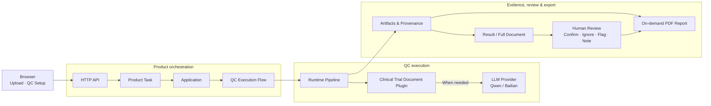

# AI QC Engine

AI QC Engine is an extensible system for evidence-grounded quality control, combining LLM-based analysis with explicit workflow orchestration, traceable artifacts, and human review.

The current domain product built on the engine is **Clinical Trial Document QC**. A domain product can contain multiple QC functions; the function currently implemented in this repository is **Writing Accuracy & Consistency Review（撰写准确性与一致性核查）**.

## Current Implementation

### Clinical Trial Document QC

The current product targets quality control for clinical-trial documents. Its architecture is intended to support multiple QC functions while sharing document intake, execution, evidence, review, and reporting infrastructure.

Its currently implemented analysis scope focuses on **investigational-product clinical safety content**, identifying substantive inaccuracies and inconsistencies and linking each finding to its source evidence.

The function architecture can support additional content scopes; those scopes are not implemented in the current repository.

Current product coverage includes:

- **Single-document DSUR, IB, and CSR:** backend execution, browser QC Setup, Result workspace, evidence-linked findings, reviewer actions, Full Document view, and PDF report export.
- **Cross-document DSUR ↔ updated IB:** implemented backend Product Task and Flow execution, with comparison in both directions.
- **Human review:** inspect source evidence, confirm or ignore findings, flag items, and save notes and document annotations.
- **Optional privacy preprocessing:** disabled by default; the default workflow does not require Paddle.

The current browser Result workspace and PDF report composition are intentionally focused on single-document review. Cross-document execution is available through the backend; a complete cross-document Result UI and A/B evidence review are not implemented.

### Product Model

```text
AI QC Engine
└── Clinical Trial Document QC
    └── Writing Accuracy & Consistency Review
        └── Investigational Product Clinical Safety  ← currently implemented analysis scope
```

The engine is designed to support reuse of execution, evidence, review, and reporting infrastructure across QC functions where their contracts are compatible. Within a QC function, domain-specific analysis scopes can be installed independently. The current repository implements one QC function and one installed analysis scope: investigational-product clinical safety. Additional QC functions and domain products are not implemented.

## Demo

▶ **[Watch the 1:28 product demo](https://www.bilibili.com/video/BV1sPJ26REKM)**

The demo shows the end-to-end workflow on the bundled error-simulation DSUR, from document upload and QC setup to finding generation, source-evidence review, and reviewer actions.

For repeated-run evaluation results and known limitations, see [Evaluation](evaluation/validation_summary.md).

## Architecture at a Glance



The diagram shows the main execution and review relationships; not every HTTP request traverses the full pipeline, and not every Runtime stage calls the Plugin or LLM.

During QC Setup, users review and adjust candidate chapters. The Flow pauses at its Candidate Scope checkpoint and resumes after confirmation. Detailed stage ownership and artifact handoffs are documented in [Architecture](ARCHITECTURE.md).

## Engineering Highlights

- Explicit orchestration and validated, versioned artifact contracts surround nondeterministic LLM calls.
- Application composition installs clinical-domain plugins without embedding their semantics in generic Flow contracts.
- Assessment, Verification, second-pass execution, and applicable consolidation/finalization produce findings with source provenance.
- Persisted Task/Flow state and separate human review records support inspection and reviewer judgment.

## Quick Start

Use **Python 3.11** (tested development environment) and **Node.js 24.x**, recommended for the current locked frontend toolchain. The commands below use PowerShell.

### Backend setup

From the repository root:

```powershell
python -m venv .venv
.\.venv\Scripts\python.exe -m pip install -r requirements.txt
```

Create a root `.env` from [.env.example](.env.example), if you do not already have one, and supply your private provider configuration:

```dotenv
DASHSCOPE_API_KEY=...
BAILIAN_BASE_URL=...
```

Both values are required by the installed Qwen/Bailian configuration. Keep credentials in environment variables or the ignored local `.env`.

Start the product backend:

```powershell
.\.venv\Scripts\python.exe backend/scripts/clinical_trial_doc_qc_server.py
```

The backend listens at `http://127.0.0.1:8765`.

### Frontend

In another terminal, from the repository root:

```powershell
cd frontend
npm install
npm run dev
```

The frontend normally opens at `http://127.0.0.1:5173`; use the URL printed by Vite if that port is occupied. Vite proxies `/api` requests to the backend.

### Try the bundled sample

Select single-document DSUR QC and use the bundled error-simulation DSUR:

`艾美妥珠单抗 研发期间安全性更新报告#2_错误模拟.docx`

It is located under:

`backend/samples/clinical_trial_doc/docx/zh/clinical_program_001_vt8802/demo/`

Browse the [demo directory](backend/samples/clinical_trial_doc/docx/zh/clinical_program_001_vt8802/demo/). This sample deliberately contains simulated errors.

1. Upload the document and start the task.
2. Review the candidate chapters in QC Setup; apply any scope changes.
3. Continue execution and open Result.
4. Inspect findings and source evidence, and use Full Document for broader review.
5. Save reviewer decisions and notes, then export the PDF report.

Executing QC uses the configured external LLM provider.

## Repository Structure

| Path                  | Purpose                                                                                    |
| --------------------- | ------------------------------------------------------------------------------------------ |
| `backend/`          | Task/Flow execution, clinical plugins, persisted artifacts, HTTP API, and report rendering |
| `frontend/`         | Browser setup and review experience                                                        |
| `backend/samples/`  | Reference documents and the error-simulation demo                                          |
| `requirements*.txt` | Runtime, development, and optional UIE dependency manifests                                |
| `ARCHITECTURE.md`   | System design and ownership boundaries                                                     |
| `LICENSE`           | Source-available evaluation terms                                                          |

## Documentation

- [Architecture](ARCHITECTURE.md) — system design, orchestration, provenance, privacy, and reporting.
- [Backend guide](backend/README.md) — installation, configuration, entrypoints, tooling, and tests.
- [Frontend guide](frontend/README.md) — local development, product journey, API integration, and checks.

## Current Scope and Boundaries

The currently implemented **Writing Accuracy & Consistency Review** processes Chinese `.docx` clinical-trial documents. Its current analysis scope is **investigational-product clinical safety content**; it does not yet cover all document content or every accuracy/consistency scope the function architecture could support. Findings require human review.

Backend DSUR ↔ updated-IB execution is implemented. The browser Result workspace and PDF composition currently serve single-document review.

PDF export is implemented and generated on demand from saved state. Immutable report archival, export versions, and a report-history UI are not implemented.

Privacy preprocessing is optional and off by default; it is not validated anonymization or guaranteed de-identification.

## License

This repository is source-available for review, local evaluation, educational inspection of this repository, and recruitment or technical assessment. Reuse in other personal or commercial projects, redistribution, and distribution of modified or derivative versions are not permitted without prior written permission.

See [LICENSE](LICENSE) for details. Third-party dependencies retain their own licenses.
